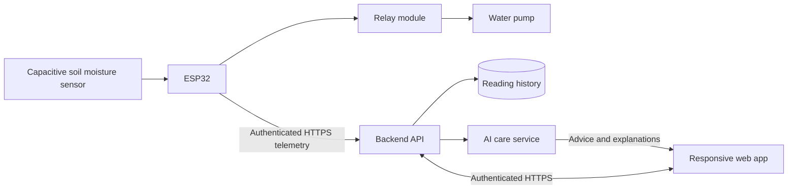

# Automated IoT Indoor Plant Monitoring System

An indoor plant monitoring project with automated watering and planned **AI-assisted Plant Care**.

**Chosen approach:** responsive web application + ESP32. The initial hardware scope is a capacitive soil moisture sensor, water pump, and power relay module. Exact board, component models, pump count, and plant species are still to be confirmed.

## Current status

This repository contains a working **browser prototype with simulated data**, a telemetry contract, and a hardware/backend implementation plan.

| Component | Status |
| --- | --- |
| Responsive dashboard and sample moisture trend | Implemented |
| Demo scenarios: normal moisture, dry soil, sensor fault | Implemented |
| Plant profile saved in the browser | Implemented |
| Export demo readings as JSON | Implemented |
| ESP32 firmware and real sensor ingestion | Planned |
| Relay/pump control and automatic watering | Planned |
| Database, authentication, remote access API | Planned |
| AI care recommendations | Planned; current preview uses simple rules |

The prototype does not communicate with hardware or control a pump. No AI model or paid service is configured.

## Run locally

No frontend dependencies or build step are required. Install Python 3, then run from the repository root:

```bash
python3 -m http.server 8080 --bind 127.0.0.1 --directory dist
```

Open **http://127.0.0.1:8080**. On Windows, use `python` or `py` instead of `python3` if needed. Node.js is optional for syntax checks:

```bash
npm run check
```

Try the sample-condition selector, refresh a sample, edit the plant profile, and export demo readings. The initial chart contains twelve simulated samples. Profile changes are stored only in that browser. Demo thresholds are illustrative and must not be copied into real watering firmware without calibration.

## Proposed system



Automatic watering belongs in the ESP32 controller so it can follow validated local settings without a browser or internet connection. AI will explain readings and suggest care; it will not directly switch the relay. Backend runtime, database, hosting, and AI provider will be selected when those stages begin.

## Repository layout

```text
dist/                     Buildless responsive dashboard
  index.html
  styles.css
  app.js                  UI, profile storage, JSON export
  telemetry.js            Simulator and demo care rules
contracts/telemetry.schema.json
examples/telemetry.json
docs/architecture.md
docs/hardware.md
docs/roadmap.md
firmware/README.md        ESP32 implementation requirements
backend/README.md         Planned API and AI integration
.openai/hosting.json      Private Sites deployment configuration
```

Start with the [roadmap](docs/roadmap.md) and [hardware details](docs/hardware.md). The [architecture](docs/architecture.md) explains the app choice and AI boundaries.

## Development

Keep Wi-Fi passwords, device credentials, database credentials, and AI keys out of Git. Use local ignored configuration for firmware and server-side secrets for the backend. The static frontend must never contain a device secret or AI API key.

Fonts load from Google Fonts with local sans-serif fallbacks. The dashboard and simulator work without that font service.

## References

- [ESP32 Arduino Wi-Fi documentation](https://docs.espressif.com/projects/arduino-esp32/en/latest/api/wifi.html)
- [Blynk web dashboards](https://docs.blynk.io/en/blynk.console/templates/dashboard)
- [Flutter web support](https://docs.flutter.dev/platform-integration/web)

No open-source license has been selected yet.
