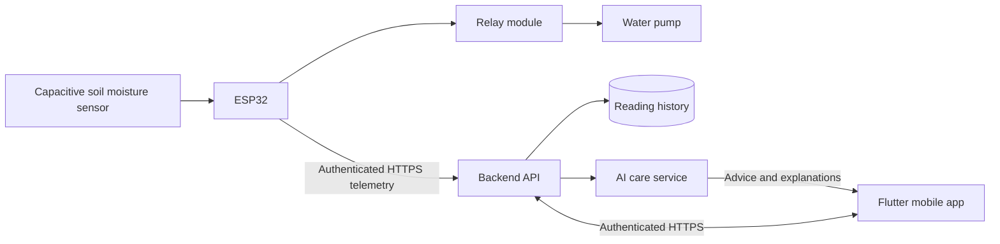

# Automated IoT Indoor Plant Monitoring System

An indoor plant monitoring project with automated watering and planned **AI-assisted Plant Care**.

**Chosen approach:** Flutter mobile application + ESP32. The initial hardware scope is a capacitive soil moisture sensor, water pump, and power relay module. Exact board, component models, pump count, and plant species are still to be confirmed.

## Current status

This repository contains a Flutter mobile app preview with simulated data, a telemetry contract, and a hardware/backend implementation plan. The earlier browser prototype remains in `dist/` as a reference; the mobile app is now the primary interface.

| Component | Status |
| --- | --- |
| Flutter mobile dashboard with simulated sensor readings | Implemented |
| Plant overview, care insight, activity, and demo watering control | Implemented |
| ESP32 firmware and real sensor ingestion | Planned |
| Relay/pump control and automatic watering | Planned |
| Database, authentication, remote access API | Planned |
| AI care recommendations | Planned; app currently shows a sample insight |

The app does not communicate with hardware or control a pump. Its watering button is a demo interaction. No AI model or paid service is configured.

## Run locally

Run the Flutter mobile app from the repository root:

```bash
cd mobile_app
flutter pub get
flutter run
```

The current dashboard uses preview data; sensor telemetry, accounts, backend AI, and real pump control are not connected yet. To check the earlier browser prototype, install Python 3 and run from the repository root:

```bash
python3 -m http.server 8080 --bind 127.0.0.1 --directory dist
```

Open **http://127.0.0.1:8080**. Node.js is optional for checking the legacy browser prototype: `npm run check`.

## Proposed system



Automatic watering belongs in the ESP32 controller so it can follow validated local settings without a browser or internet connection. AI will explain readings and suggest care; it will not directly switch the relay. Backend runtime, database, hosting, and AI provider will be selected when those stages begin.

## Repository layout

```text
mobile_app/               Flutter mobile application
  lib/main.dart           Plant dashboard preview and demo interactions
dist/                     Earlier browser prototype kept for reference
  index.html
  styles.css
  app.js                  UI, profile storage, JSON export
  telemetry.js            Simulator and demo care rules
contracts/telemetry.schema.json
examples/telemetry.json
docs/architecture.md
docs/hardware.md
docs/roadmap.md
firmware/README.md        ESP32 implementation requirements
backend/README.md         Planned API and AI integration
.openai/hosting.json      Private Sites deployment configuration
```

Start with the [roadmap](docs/roadmap.md) and [hardware details](docs/hardware.md). The [architecture](docs/architecture.md) explains the mobile app, data flow, and AI boundaries.

## Development

Keep Wi-Fi passwords, device credentials, database credentials, and AI keys out of Git. Use local ignored configuration for firmware and server-side secrets for the backend. Never embed a device secret or AI provider key in the mobile app.

## References

- [ESP32 Arduino Wi-Fi documentation](https://docs.espressif.com/projects/arduino-esp32/en/latest/api/wifi.html)
- [Flutter documentation](https://docs.flutter.dev/)

No open-source license has been selected yet.
